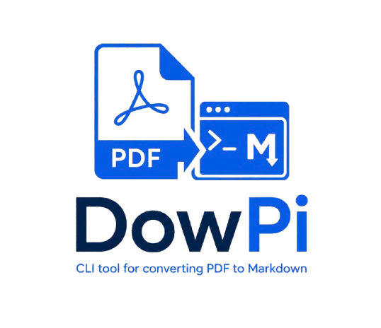

<p align="center">
  
</p>

# DowPi

Converte PDF in Markdown ottimizzato per gli LLM: struttura semantica (heading, liste,
tabelle), rimozione del rumore (header/footer ripetuti, numeri di pagina, separatori) e
meno token possibile.

## Installazione

Richiede Python 3.10+.

```sh
git clone https://github.com/DiscoHDuBois/DowPi.git
cd DowPi
pip install .
```

## Uso

```sh
dowpi documento.pdf                  # crea documento.md
dowpi documento.pdf -o note.md       # percorso di output esplicito
dowpi documento.pdf -p 1-5,8         # converte solo alcune pagine
dowpi documento.pdf --no-images      # non estrarre le immagini
dowpi documento.pdf --keep-headers   # mantieni header/footer ripetuti
```

Le immagini estratte finiscono in `<output>_images/` accanto al file Markdown e sono
referenziate con percorsi relativi.

## Roadmap

- `--diagrams llm` (opt-in): conversione dei diagrammi tramite LLM multimodale — Mermaid
  per gli schemi a blocchi, netlist/descrizione strutturata per gli schemi circuitali.
